# ⚡ WaferFab Intelligence
### Machine-Learning-Based Defect Classification in Semiconductor Manufacturing

[](https://www.python.org/)
[](https://xgboost.ai/)
[](https://scikit-learn.org/)
[](https://numpy.org/)
[](https://pandas.pydata.org/)
[](https://plotly.com/)
[](https://streamlit.io/)
[](https://developer.mozilla.org/docs/Web/JavaScript)
[](https://nodejs.org/)
[](https://developer.mozilla.org/docs/Web/HTML)
[](https://developer.mozilla.org/docs/Web/CSS)
[](https://vercel.com/)
[](https://github.com/features/actions)
[](https://cense.iisc.ac.in/)

> **Author:** Shrikant Subhash Kudale — MIT-ADT University, Pune (B.Tech CSE – AI & Analytics)
> **Program:** MoTA Foundation Training Program on Semiconductor Fabrication & Characterization
> **Host:** Centre for Nano Science and Engineering (CeNSE), IISc Bengaluru · 8–19 June 2026 · Section 2 (Practical-Based), Topic 20
> **Repository:** <https://github.com/Shrikant-Kudale/Semiconductor-Wafer-Defect-Classifier---CeNSE-IISc-Bangalore>

---

## 📑 Table of Contents

1. [What is this project?](#1--what-is-this-project)
2. [The big picture (flow chart)](#2--the-big-picture)
3. [Background: how a chip is made](#3--background-how-a-chip-is-made)
4. [Background: defects in semiconductor manufacturing](#4--background-defects-in-semiconductor-manufacturing)
5. [The 9 defect classes](#5--the-9-defect-classes)
6. [Data: what the model sees](#6--data-what-the-model-sees)
7. [Machine-learning pipeline](#7--machine-learning-pipeline)
8. [The model: XGBoost explained simply](#8--the-model-xgboost-explained-simply)
9. [The dashboard: what it does](#9--the-dashboard-what-it-does)
10. [How to operate it (user guide)](#10--how-to-operate-it)
11. [Technology stack & symbols](#11--technology-stack--symbols)
12. [Architecture: Streamlit → Vercel migration](#12--architecture-streamlit--vercel-migration)
13. [Comparative tables](#13--comparative-tables)
14. [REST API](#14--rest-api)
15. [Running, testing and deploying](#15--running-testing-and-deploying)
16. [Project structure](#16--project-structure)
17. [Validation & reproducibility](#17--validation--reproducibility)
18. [Limitations & future scope](#18--limitations--future-scope)
19. [Glossary](#19--glossary)
20. [References & credits](#20--references--credits)

---

## 1. 🎯 What is this project?

**WaferFab Intelligence** is a *predictive diagnostic system* for semiconductor wafers. Given measurements collected during fabrication (inspection statistics and process-metrology values), it tells a process engineer:

* **Which defect pattern** the wafer most likely shows (one of 9 standard classes),
* **How confident** the model is, and **why** it decided that,
* **What process area** is the probable root cause, and what to investigate first.

**Why it matters**

| Problem in a fab | How this project helps |
|---|---|
| Chips need 300–1000+ sequential process steps; one bad step can ruin a lot | Flags the defect pattern early so the responsible tool/step can be checked |
| Manual optical/SEM review is slow, subjective, not scalable | Automatic, repeatable classification in milliseconds |
| Even a 1 % yield gain on a high-volume line is worth a lot of money | Faster root-cause direction → less scrap, shorter excursions |
| Models are often "black boxes" engineers don't trust | Every prediction is explained feature-by-feature (TreeSHAP) |

**Scope:** an educational / proof-of-concept project trained on **simulated** data (real fab data is confidential). The pipeline is designed to transfer to real datasets such as **WM-811K**.

---

## 2. 🗺️ The big picture

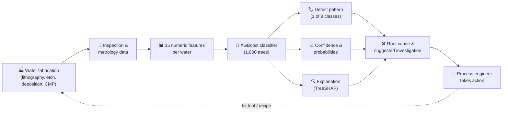

---

## 3. 🏭 Background: how a chip is made

A chip is built layer by layer on a thin disc of silicon called a **wafer**. The same sequence of steps repeats many times (once per layer).

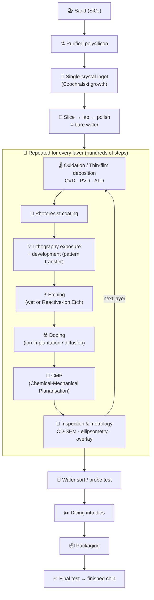

| Step | What happens | Typical tools / techniques |
|---|---|---|
| **Wafer preparation** | Grow, slice and polish single-crystal silicon | Czochralski puller, wire saw, CMP |
| **Deposition** | Add thin films (oxide, nitride, metal, poly-Si) | CVD, PVD (sputtering), ALD |
| **Lithography** | Print the circuit pattern into photoresist | Scanner/stepper, DUV / EUV |
| **Etching** | Remove material where the resist does not protect it | Wet etch, Reactive Ion Etching (RIE) |
| **Doping** | Change electrical behaviour of silicon regions | Ion implantation, diffusion |
| **Planarisation** | Flatten the surface between layers | CMP |
| **Metrology & inspection** | Measure thickness, line width, alignment, particles | Ellipsometer, CD-SEM, overlay tool, optical inspection |
| **Back-end** | Test, dice, package | Probe station, dicing saw, wire-bond / flip-chip |

---

## 4. 🔎 Background: defects in semiconductor manufacturing

A **defect** is any physical or electrical imperfection that can make a die (one chip on the wafer) fail or degrade. Defects are grouped by origin:

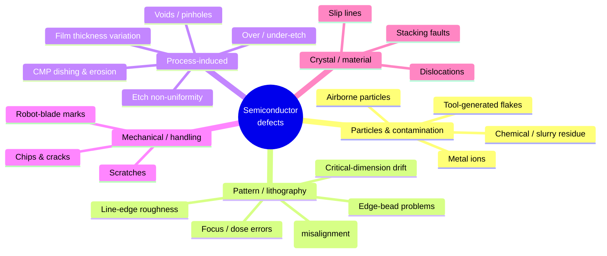

| Defect family | Physical cause | Typical effect | Typical signal in data |
|---|---|---|---|
| **Particles** | Cleanroom/tool contamination | Shorts or opens | ↑ particle index, ↑ random defect count |
| **Overlay error** | Layer-to-layer misregistration | Mis-aligned vias / contacts | ↑ overlay (nm) |
| **CD variation** | Dose/focus/etch drift | Transistor speed & leakage spread | CD away from target (nm) |
| **Line-edge roughness** | Resist/etch stochastics | Variability, leakage | ↑ roughness (nm) |
| **Film thickness error** | Deposition/oxidation drift | Threshold-voltage shift, breakdown | Oxide thickness off target |
| **Etch non-uniformity** | Plasma/gas distribution | Centre/edge/ring patterns | ↓ etch uniformity (%) |
| **CMP non-uniformity** | Pad wear, slurry, pressure zones | Centre, donut or edge patterns | Radial pattern in wafer map |
| **Scratches** | Handling, slurry agglomerates | Line of failing dies | Large linear cluster |
| **Gross excursion** | Whole-process failure | Almost all dies fail | Very high count, low yield |

> **Yield** = good dies ÷ total dies. Defects reduce yield; classifying *where and how* they appear (the wafer-map pattern) points to the *cause*.

---

## 5. 🧩 The 9 defect classes

Taxonomy follows the industry-standard **WM-811K** wafer-map patterns. Each class has a distinct likely root cause.

| # | Class | Visual signature | Likely root cause | Process area | Status in dashboard |
|---|---|---|---|---|---|
| 1 | 🟢 **Normal** | No systematic pattern | Healthy process | — | STABLE |
| 2 | 🟣 **Center** | Failures concentrated in the middle | CMP pad centre-wear, deposition non-uniformity | CMP / Deposition | ALERT |
| 3 | 🟪 **Donut** | Ring at mid-radius | Etch / CMP non-uniformity at mid-radius | Etch / CMP | ALERT |
| 4 | 🟠 **Edge-Loc** | Local cluster at the wafer edge | Edge-bead removal issue, edge handling | Lithography / Handling | WATCH |
| 5 | 🔴 **Edge-Ring** | Ring around the whole edge | Edge-exclusion-zone process drift | Etch / Deposition | ALERT |
| 6 | 🔵 **Loc** | Local blob somewhere on the wafer | Local contamination / particle event | Contamination | WATCH |
| 7 | ⚪ **Random** | Scattered failures everywhere | Background defectivity, random particles | Cleanroom | WATCH |
| 8 | 🟦 **Scratch** | Thin line / arc of failures | Wafer handling, robot-arm scratch | Handling / CMP | ALERT |
| 9 | 🟥 **Near-Full** | Almost every die fails | Major process excursion (gross film failure) | Whole flow | CRITICAL · HOLD LOT |

**Hard-to-separate pairs** (also noted in the project's literature review): *Edge-Loc vs Edge-Ring* and *Donut vs Center/Loc* look alike at low resolution — which is why the model also confidence-scores every prediction.

---

## 6. 📊 Data: what the model sees

The dataset is **simulated but domain-realistic** (no confidential fab data). For each class, a synthetic wafer map is generated and summary features are derived from it; process-metrology values are simulated with class-dependent correlations (for example, etch drift correlating with Edge-Ring patterns).

| Item | Value |
|---|---|
| Tabular dataset | ≈ 5,400 simulated wafers (≈ 600 per class × 9 classes) |
| Wafer-map image dataset | 2,700 maps (300 per class), 32 × 32 die grid, 0 = pass, 1 = fail |
| Split | 70 % train / 15 % validation / 15 % test, stratified, fixed `random_state` |
| Class balance | Intentionally mimics fabs: *Normal* and *Random* common, *Near-Full* and *Donut* rarer |
| Target | `defect_class` (9 categories) |

### The 15 input features

| # | Feature | Group | Unit | Meaning | Training mean ± σ | Importance (gain) |
|---|---|---|---|---|---|---|
| 1 | `defect_count` | Spatial | dies | Total failing dies/defects | 134.5 ± 156.6 | 13.7 % |
| 2 | `defect_density` | Spatial | — | Defects per unit area | 0.166 ± 0.193 | **0 %** (unused) |
| 3 | `mean_radial_position` | Spatial | r/R | Mean defect radius (0 centre → 1 edge) | 0.613 ± 0.167 | 12.9 % |
| 4 | `std_radial_position` | Spatial | r/R | Spread of defect radius | 0.190 ± 0.056 | 5.2 % |
| 5 | `edge_ratio` | Spatial | — | Fraction of defects in edge zone | 0.370 ± 0.290 | 13.4 % |
| 6 | `center_ratio` | Spatial | — | Fraction of defects in centre zone | 0.221 ± 0.252 | 10.1 % |
| 7 | `cluster_count` | Spatial | — | Number of defect clusters | 28.3 ± 24.4 | 12.4 % |
| 8 | `max_cluster_size` | Spatial | dies | Largest cluster | 70.1 ± 145.7 | 9.9 % |
| 9 | `oxide_thickness_nm` | Process | nm | Oxide film thickness | 100.35 ± 2.23 | 0.6 % |
| 10 | `critical_dimension_nm` | Process | nm | Printed feature width | 45.08 ± 1.53 | 0.1 % |
| 11 | `overlay_error_nm` | Process | nm | Layer-to-layer misalignment | 3.63 ± 1.07 | 0.2 % |
| 12 | `line_edge_roughness_nm` | Process | nm | Edge roughness | 2.14 ± 0.55 | 10.4 % |
| 13 | `etch_uniformity_pct` | Process | % | Across-wafer etch uniformity | 94.57 ± 2.29 | 0.4 % |
| 14 | `particle_contamination_index` | Process | — | Particle level | 6.36 ± 2.43 | 1.8 % |
| 15 | `wafer_yield_pct` | Process | % | Probe-test yield | 83.5 ± 19.4 | 8.8 % |

> 💡 Means/σ come from the fitted `StandardScaler` (training population). The model mainly relies on the **spatial** features; `defect_density` is never used in a split.

---

## 7. 🤖 Machine-learning pipeline

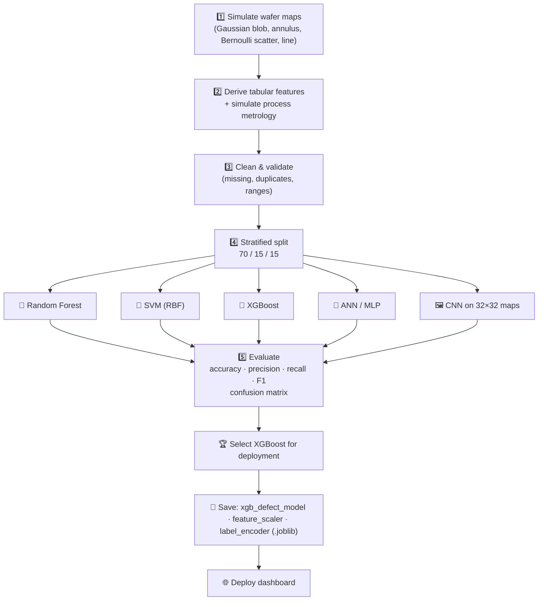

**Models compared in the project**

| Model | Input | Config | Scaling needed? | Notes |
|---|---|---|---|---|
| Random Forest | Tabular | 200 trees | No | Robust, gives importances |
| SVM | Tabular | RBF kernel, C = 10, gamma = scale | **Yes** | Good on well-scaled numeric data |
| **XGBoost** ✅ | Tabular | 200 estimators, lr 0.1, depth 6 | No | **Deployed model**; strongest tabular baseline |
| ANN / MLP | Tabular | Dense 64 → 32 → 9, ReLU, softmax | **Yes** | Simple deep baseline |
| CNN | 32 × 32 wafer map | Conv(32)→Pool→Conv(64)→Pool→Dense(128)→Dropout 0.3→Softmax(9) | Pixels 0/1 | Strong on shape-defined classes; **not part of the deployed dashboard** |

**Key finding of the project:** both branches exceeded the 85 % accuracy target on the simulated data, and they are *complementary* — the tabular branch is stronger on globally-aggregated classes (Random, Near-Full, Edge-Ring), the CNN on shape-defined classes (Donut, Center, Scratch). That motivates a hybrid model as future work.

---

## 8. 🚀 The model: XGBoost explained simply

**XGBoost** (eXtreme Gradient Boosting) builds many small decision trees one after another; each new tree corrects the mistakes of the previous ones.

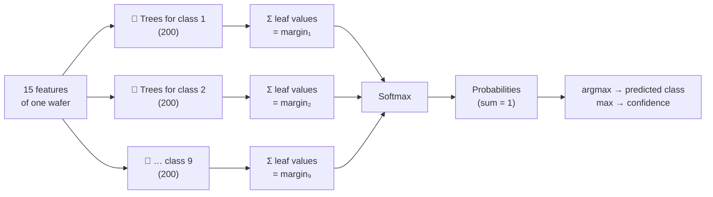

| Property | Value |
|---|---|
| Objective | `multi:softprob` (9 classes) |
| Boosting rounds | 200 |
| Trees in total | 200 × 9 = **1,800** |
| Max depth | 6 |
| Learning rate | 0.1 |
| Trained on | Raw (unscaled) features — trees do not need scaling |

**Explainability (TreeSHAP):** for each prediction, every feature gets a signed contribution to the class score (log-odds). *Base value + Σ contributions = model margin.* This shows, for example, that for an Edge-Ring wafer the high *mean radial position* and *edge ratio* push the decision towards Edge-Ring.

---

## 9. 🖥️ The dashboard: what it does

| Tab | What you get |
|---|---|
| **Diagnose** | Predicted pattern, confidence ring, margin to runner-up, uncertainty, graded status, root cause + suggested action, reconstructed 32×32 wafer map, radial density profile, probability bars for all 9 classes, z-score "process fingerprint" radar, out-of-distribution & low-confidence warnings |
| **Explain** | TreeSHAP waterfall for any class, global feature importance (gain / cover / splits), full input table with z-scores and illustrative spec check |
| **What-if** | Sensitivity sweep of one feature (with decision boundaries), Monte-Carlo robustness to measurement noise, counterfactual search "what smallest changes reach class X?" (with parameter locks) |
| **Batch** | Upload a CSV, score many wafers at once, class mix, confidence histogram, OOD count, download results |
| **Model & API** | Model card, defect taxonomy, live API tester, scope & limitations |

Other features: 🌗 day/night theme · 📱 mobile layout · 🔗 shareable link of the exact wafer · 📴 works offline (PWA) · 🧪 automated tests.

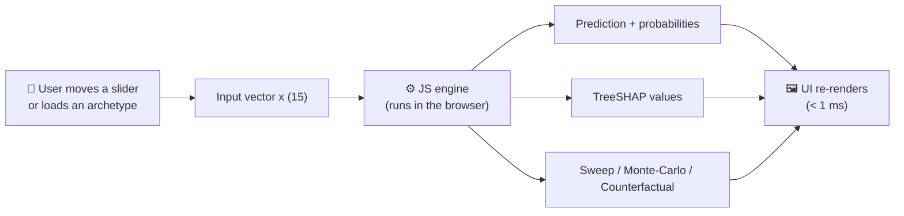

---

## 10. 🕹️ How to operate it

### 10.1 Using the dashboard
1. **Open the app** (Vercel URL or `http://localhost:3000`).
2. **Pick a starting point:** click an **archetype wafer** chip (e.g. *Edge-Ring*) or move the sliders manually.
3. **Read the verdict:** class, confidence, status, and the root-cause box.
4. **Check warnings:** an amber banner means an input is outside the training range (|z| > 3) or confidence is below 60 %.
5. **Go to Explain** to see *why* — long bars in the waterfall are the main drivers.
6. **Go to What-if** to test stability: sweep a feature, add noise, or search for changes that move the wafer to *Normal*.
7. **Share:** the 🔗 button copies a link that reopens the exact same wafer.
8. **Toggle 🌗** for day/night mode.

> 🔒 The padlock beside a slider freezes that parameter during counterfactual search. The dashed band on each slider shows the training range (mean ± 3σ); the green strip is an *illustrative* spec window.

### 10.2 Batch CSV scoring
* Go to **Batch** → drop a `.csv` (or click *Load demo lot*).
* Columns: the 15 feature names (any order, optional `wafer_id`) **or** 15 numeric columns in the standard order.
* Everything is processed in your browser; nothing is uploaded.
* *Download results CSV* gives the prediction, confidence, status, runner-up, OOD count and all 9 probabilities per wafer.

```csv
wafer_id,defect_count,defect_density,mean_radial_position,std_radial_position,edge_ratio,center_ratio,cluster_count,max_cluster_size,oxide_thickness_nm,critical_dimension_nm,overlay_error_nm,line_edge_roughness_nm,etch_uniformity_pct,particle_index,wafer_yield_pct
W-001,159,0.265,0.988,0.236,0.95,0.167,36,27,99.9,44.5,3.48,1.6,92.8,5.6,74.1
```

### 10.3 Reading the outputs

| Output | How to interpret |
|---|---|
| **Confidence** | Probability of the top class. < 60 % → ambiguous, review manually |
| **Margin to #2** | Gap between top two classes; small margin = easily confused pair |
| **Uncertainty (H)** | Normalised entropy 0–1; 0 = certain, 1 = completely undecided |
| **Status** | STABLE → WATCH → ALERT → CRITICAL, from the class severity |
| **z-score** | Distance from the training mean in σ; \|z\| > 3 = extrapolation |
| **SHAP bar** | Positive = pushes towards the class; negative = pushes away |

### 10.4 Decision workflow for an engineer

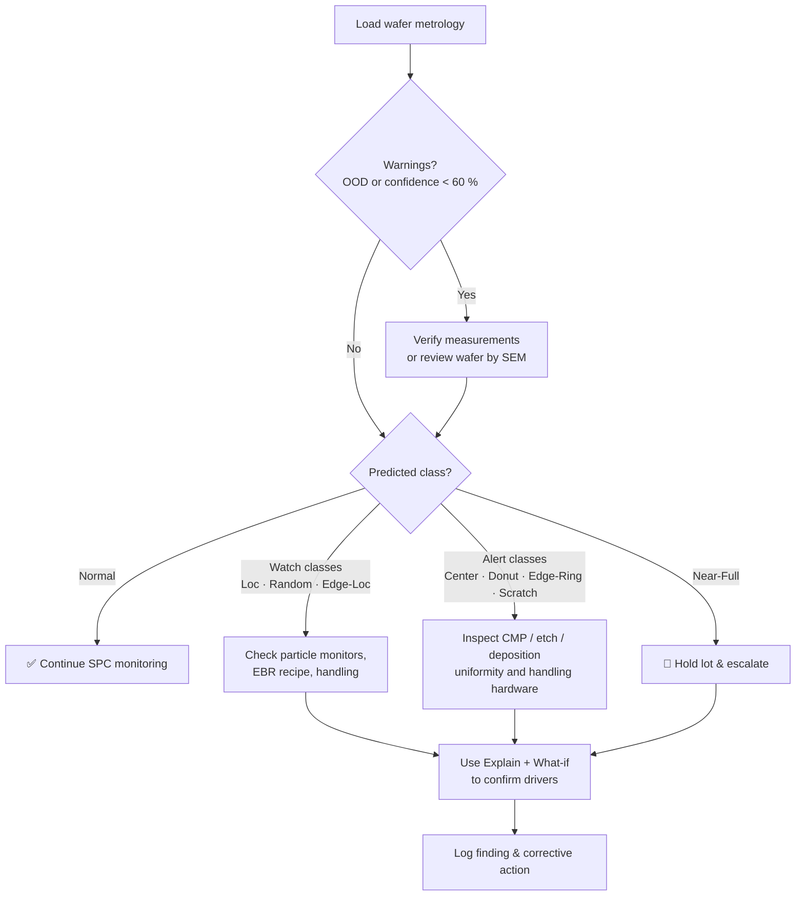

---

## 11. 🧰 Technology stack & symbols

| Symbol | Technology | Role in the project |
|---|---|---|
| 🐍 **Python** | Language | Data simulation, training, model export |
| 🚀 **XGBoost** | Gradient-boosted trees | The classifier (9 classes, 1,800 trees) |
| 🔬 **scikit-learn** | ML toolkit | `StandardScaler`, `LabelEncoder`, baselines (RF, SVM) |
| 🔢 **NumPy** | Numerical arrays | Feature vectors, maths |
| 🐼 **Pandas** | Tabular data | Datasets, feature tables |
| 📦 **Joblib** | Serialisation | Saving/loading the trained artefacts |
| 📊 **Plotly** | Charts | Original dashboard charts |
| 🎈 **Streamlit** | Python web framework | Original (v1) dashboard |
| 🟨 **JavaScript (ES2020)** | Language | In-browser inference engine & UI |
| 🟩 **Node.js 22** | Runtime | Serverless API + tests |
| 🌐 **HTML5 / CSS3** | Web standards | Interface, day/night theming |
| 🎨 **SVG / Canvas** | Graphics | Charts and wafer map (no chart library needed) |
| ▲ **Vercel** | Hosting | Static site + serverless functions, global CDN |
| 🔄 **Service Worker / PWA** | Web standard | Offline use, installable app |
| 🤖 **GitHub Actions** | CI | Runs the test-suite on every push |
| 🧪 **node:test** | Testing | Parity and API tests |
| 🧠 **TreeSHAP** | Explainability | Exact per-prediction feature attributions |
| 📘 **OpenAPI 3** | API spec | Machine-readable API description |
| 🧮 **COMSOL, Altium, SEM/TEM, JMP** | Covered in the MoTA program | Context for the wider training (not used in the code) |

---

## 12. 🔄 Architecture: Streamlit → Vercel migration

**The problem:** Streamlit Community Cloud puts apps to sleep after inactivity; the first visitor waits while it "wakes up".

**The obstacle to a simple lift-and-shift:** Vercel Python functions are limited to 250 MB unzipped, and the `xgboost` package (plus the NVIDIA libraries it pulls in on Linux) is larger than that.

**The solution:** export the trained trees to JSON and run them in JavaScript, in the browser. No Python server is needed at all.

### Before (v1)


### After (v2)

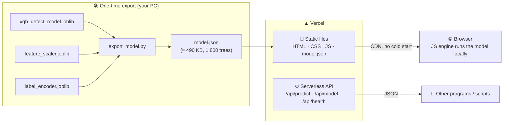

### Deployment flow

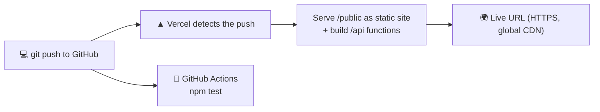

### Request lifecycle comparison

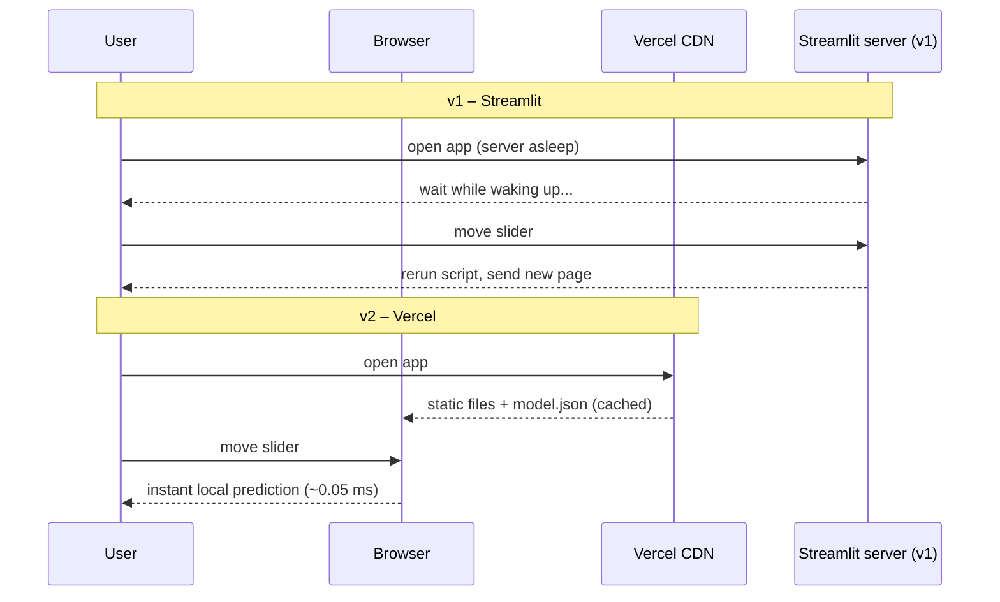

---

## 13. ⚖️ Comparative tables

### 13.1 Version 1 (Streamlit) vs Version 2 (Vercel)

| Aspect | v1 – Streamlit | v2 – Vercel |
|---|---|---|
| Hosting | Streamlit Community Cloud | Vercel (CDN + serverless) |
| Idle behaviour | **Sleeps**, needs wake-up | **Always instant** |
| Where the model runs | Python server | The user's browser (JS) |
| Python needed at runtime | Yes | No |
| Interaction | Script re-runs on each change | Instant local update |
| Explainability | None | Exact TreeSHAP |
| Outputs | Class, confidence, bar chart, table | Verdict, wafer map, SHAP, radar, sweeps, Monte-Carlo, counterfactuals |
| Out-of-range protection | None | z-score OOD warnings |
| Batch scoring | No | CSV in/out |
| API | No | REST + OpenAPI |
| Offline | No | Yes (PWA) |
| Themes / mobile | Light, desktop-oriented | Day/night, responsive |
| Tests | None | Parity + SHAP + API tests, CI |

### 13.2 Tabular (metrology) branch vs Image (CNN) branch

| | Tabular – XGBoost | Image – CNN |
|---|---|---|
| Input | 15 numbers | 32 × 32 wafer map |
| Training speed | Seconds | Minutes |
| Best at | Global statistics: Random, Near-Full, Edge-Ring | Shapes: Donut, Center, Scratch |
| Explainable | Yes (TreeSHAP) | Harder |
| Size | ≈ 490 KB exported | Larger |
| In this dashboard | ✅ Deployed | ❌ Future hybrid |

### 13.3 Why XGBoost for deployment

| Criterion | RF | SVM | **XGBoost** | ANN |
|---|---|---|---|---|
| Works on raw features | ✅ | ❌ needs scaling | ✅ | ❌ needs scaling |
| Strong on tabular data | ✅ | ◻️ | ✅✅ | ◻️ |
| Easy exact explanations | ✅ | ❌ | ✅ (TreeSHAP) | ❌ |
| Easy to export to JSON / run anywhere | ◻️ | ◻️ | ✅ | ◻️ |

### 13.4 Old vs new input ranges

| Feature | v1 slider | v2 slider | Training mean ± σ |
|---|---|---|---|
| Cluster count | 0–20 | 0–80 | 28 ± 24 |
| Largest cluster | 0–100 | 0–300 | 70 ± 146 |
| Oxide thickness | 80–120 nm | 80–120 nm + training band | 100.4 ± 2.2 nm |
| Others | as original | as original + training band | see §6 |

---

## 14. 🔌 REST API

| Endpoint | Method | Purpose |
|---|---|---|
| `/api/predict` | `POST` | Classify one wafer (optionally with SHAP) or a batch (≤ 5,000) |
| `/api/model` | `GET` | Model metadata, class list, feature importances |
| `/api/health` | `GET` | Liveness probe |
| `/openapi.json` | `GET` | API specification |

```bash
curl -X POST https://<your-app>.vercel.app/api/predict \
  -H "Content-Type: application/json" \
  -d '{"features":[159,0.265,0.988,0.236,0.95,0.167,36,27,99.9,44.5,3.48,1.6,92.8,5.6,74.1],"explain":true}'
```

`features` can be an array of 15 numbers or an object keyed by feature name. Response includes `label`, `confidence`, `status`, `probabilities`, `outOfDistribution` and (with `explain`) the SHAP values.

---

## 15. ▶️ Running, testing and deploying

### Prerequisites
* **Node.js 22+** (running and tests) · **Python 3.10+** only if you want to re-export a retrained model.

### Run locally
```bash
npm start          # http://localhost:3000  (static site + /api)
# or emulate Vercel exactly
npm i -g vercel && vercel dev
```

### Test
```bash
npm test           # parity vs Python, TreeSHAP, API handler
```

### Deploy to Vercel
**Option A – GitHub import (recommended):** push the project to GitHub → <https://vercel.com/new> → import → *Framework: Other*, *Build command: empty*, *Output directory: `public`* → Deploy.
**Option B – CLI:** `vercel` (preview), `vercel --prod` (production). No environment variables needed.

### Retrain / replace the model
```bash
pip install -r scripts/requirements.txt
# put the 3 .joblib files into /models, then
npm run export                       # regenerates public/data/model.json and meta.json
python scripts/make_presets.py && python scripts/make_golden.py
npm test
```

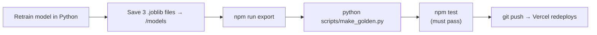

---

## 16. 🗂️ Project structure

```
waferfab-intelligence/
├── public/                    # Static site served by Vercel
│   ├── index.html             # Page layout (5 tabs)
│   ├── css/style.css          # Day/night themes, responsive layout
│   ├── js/engine.js           # XGBoost inference + TreeSHAP + what-if tools
│   ├── js/charts.js           # SVG charts (ring, radar, waterfall, lines, histogram)
│   ├── js/app.js              # UI logic, wafer map, batch, API tester
│   ├── data/model.json        # Exported model (1,800 trees)
│   ├── data/meta.json         # Feature/class metadata + archetype wafers
│   ├── openapi.json  sw.js  manifest.webmanifest  favicon.svg
├── api/                       # Serverless functions (Node 22)
│   ├── predict.js  model.js  health.js  _lib.js
├── models/                    # Original .joblib artefacts
├── scripts/                   # export_model.py, build_meta.py, make_presets.py, make_golden.py, serve.js
├── tests/                     # engine.test.js + golden.json (Python reference outputs)
├── legacy/                    # Original Streamlit app (streamlit_app.py)
├── vercel.json  package.json  README.md
└── .github/workflows/ci.yml   # Continuous integration
```

---

## 17. ✅ Validation & reproducibility

| Check | Result |
|---|---|
| JS vs Python probabilities (69 reference wafers) | max difference 6.6 × 10⁻⁷, identical predicted class on all |
| TreeSHAP vs XGBoost `pred_contribs` | max difference 1.3 × 10⁻⁶; efficiency axiom holds |
| Inference speed (Node 22) | ≈ 0.05 ms per prediction, ≈ 0.6 ms per explanation |
| API handler | single, batch, named-feature and validation paths tested |
| UI | smoke-tested in headless Chromium (light/dark, all tabs, mobile) with no console errors |

Fixed random seeds are used for training, the wafer-map rendering and Monte-Carlo, so results are repeatable.

---

## 18. ⚠️ Limitations & future scope

**Limitations**
* Data are **simulated**; results are a proof of concept, not production-validated.
* Real inspection resolution is far higher than the 32 × 32 simulated maps.
* The dashboard's wafer map is a *schematic reconstruction* from summary statistics, not a measured image.
* Spec windows and suggested actions are illustrative guidance, not fab specifications.
* Counterfactuals show the model's decision surface, not physical causality.
* The CNN branch is evaluated in the project but not deployed here.

**Future scope**
1. Validate on the real **WM-811K** dataset.
2. Deeper image models (ResNet-style blocks, transfer learning).
3. A true **hybrid** model: CNN features + tabular metrology before the final classifier.
4. Integration with **SPC dashboards** for real-time root-cause flagging.
5. **Edge deployment** on fab-floor inspection systems.

---

## 19. 📖 Glossary

| Term | Meaning |
|---|---|
| **Wafer** | Thin disc of silicon on which many chips (dies) are built |
| **Die** | One chip on a wafer |
| **Fab** | Semiconductor fabrication plant |
| **Yield** | Fraction of good dies |
| **Wafer map** | 2-D map of pass/fail dies on a wafer |
| **WM-811K** | Public wafer-map dataset with the standard failure patterns |
| **Lithography** | Printing the circuit pattern with light |
| **CVD / PVD / ALD** | Chemical / Physical vapour deposition / Atomic-layer deposition (thin films) |
| **RIE** | Reactive-Ion Etching |
| **CMP** | Chemical-Mechanical Planarisation |
| **CD** | Critical dimension (smallest printed feature width) |
| **LER** | Line-edge roughness |
| **Overlay** | Alignment accuracy between layers |
| **SPC** | Statistical Process Control |
| **SEM / TEM** | Scanning / Transmission Electron Microscope |
| **PPO / OOD** | (OOD) Out-of-distribution: input outside the training range |
| **XGBoost** | Gradient-boosted decision-tree algorithm |
| **Softmax** | Converts class scores into probabilities that sum to 1 |
| **SHAP / TreeSHAP** | Method assigning each feature a fair contribution to a prediction |
| **Log-odds / margin** | Raw model score before softmax |
| **z-score** | Number of standard deviations from the training mean |
| **Monte-Carlo** | Repeating a calculation with random noise to test stability |
| **Counterfactual** | "What would need to change for a different outcome?" |
| **PWA** | Progressive Web App (installable, works offline) |
| **Serverless** | Code run on demand without managing a server |

---

## 20. 📚 References & credits

* Wu, M.-J., Jang, J.-S. R., & Chen, J.-L. (2015). *Wafer map failure pattern recognition and similarity ranking for large-scale data sets.* IEEE Trans. Semiconductor Manufacturing. (WM-811K)
* Chen, T., & Guestrin, C. (2016). *XGBoost: A scalable tree boosting system.* KDD.
* Lundberg, S. M., Erion, G. G., & Lee, S.-I. (2018). *Consistent individualized feature attribution for tree ensembles.* (TreeSHAP)
* Literature listed in the project presentation (Hsu & Chen 2020; Chu et al. 2021; Kuo & Chang 2022; Wang & Gao 2021; Liu & Zhang 2022; and others).

**Acknowledgements:** MoTA Foundation Training Program · Centre for Nano Science and Engineering (CeNSE), IISc Bengaluru · MIT-ADT University, Pune.

*Built with 💜 for the MoTA Foundation Training Program at CeNSE, IISc Bengaluru.*
